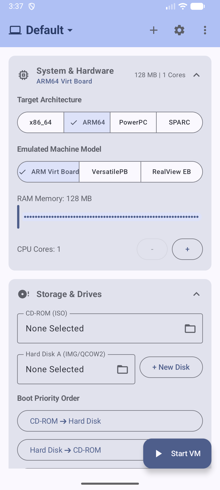
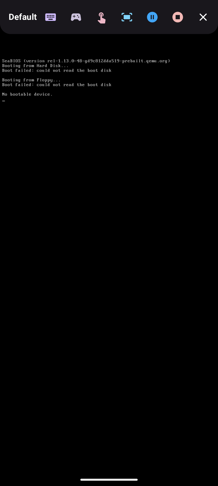

# 🚀 LimboFork: Modernized PC Emulator for Android

> **A vibecoded, open-source revival and modern rewrite of the classic GPL [Limbo PC Emulator](https://github.com/limboemu/limbo) for Android 15 (SDK 35), Jetpack Compose Material 3, and Modern Foldables.**


---

## 📸 Screenshots & UI Showcase

| Material 3 Jetpack Compose Dashboard | Glassmorphic Floating SDL Control Overlay |
| :---: | :---: |
|  |  |

---

## ✨ Highlights & What's New

### 📱 Single Unified All-In-One Application
* **One App to Rule Them All**: Replaced the legacy 2012 multi-submodule split (`Limbo x86`, `Limbo ARM`, `Limbo PowerPC`, `Limbo SPARC`) with a **Single Unified Android Application**.
* **Seamless Architecture Switcher**: Switch target guest architectures (`x86_64`, `ARM64`, `PowerPC`, `SPARC`) directly on the dashboard screen without downloading or switching between separate apps.

### 🎨 Modern Jetpack Compose Material 3 Dashboard
* **Human-Readable Machine Profiles**: Displays human-readable machine models for all QEMU engines:
  * 🍎 **PowerPC**: *Apple Power Mac G4 / iMac G3 (`mac99`)*, *Power Mac G3 (Beige)*
  * 💻 **x86 / x86_64**: *Standard Intel/AMD PC (`i440FX`)*, *Modern PC (`Q35`)*
  * 📱 **ARM / ARM64**: *ARM64 Virt Board*, *VersatilePB*
  * ☀️ **SPARC / SPARC64**: *Sun SPARCstation 5 (`SS-5`)*, *Sun UltraSPARC Workstation (`sun4u`)*
* **Interactive Controls**: Dynamic RAM & CPU core sliders, QEMU machine model selector, network adapters, sound cards, VGA emulation (`std`, `cirrus`, `vmware`, `qxl`), and advanced arguments.
* **`+ New Disk` Qcow2 Creator**: Built-in sparse `qcow2` hard disk image generator (`1 GB`, `2 GB`, `4 GB`, `10 GB`, `20 GB`).

### 🎮 Material Expressive Floating SDL Overlay
* **Floating Control Pill**: Semi-transparent dark glassmorphism overlay bar anchored directly over the running QEMU framebuffer.
* **Quick Special Keypad**: On-screen chips for `Ctrl + Alt + Del`, `Send Text`, `Esc`, `Tab`, `Ctrl`, `Alt`, `F1-F12`, and Arrow keys.
* **Display Scale & Zoom Toggle**: Instant single-tap button to cycle between:
  1. 📺 **Fit Screen**: Centered 4:3 native aspect ratio with clean letterboxing.
  2. ↕️ **Stretch to Fill**: 100% full screen expansion.
  3. 🔍 **Zoom 1.35x**: Magnifies guest OS display for easy readability.
* **Mouse Mode Switcher**: Seamlessly toggle between **Trackpad Mode** and **Direct Touchscreen Mode**.

### 📐 Foldable & Large Screen Adaptive Layout
* **Foldable Responsive Grid**: Automatically transitions into a **2-Column Adaptive Grid** when unfolded on Galaxy Z Fold, Pixel Fold, Motorola Razr, or Android tablets, and scales back into a single column when folded.
* **System Bar & Cutout Insets**: Fully compliant with Android 15 edge-to-edge layout, status bar insets, and camera hole-punch display cutouts.

### 🛡️ Modern Android 15 & Build System
* **SDK 35 & Java 17 Toolchain**: Built with Gradle 8.13, AGP 8.8.0, Kotlin 2.0.21, and Java 17.
* **SAF Integration**: System Document Picker (`Intent.ACTION_OPEN_DOCUMENT`) for storage image selection.
* **Android 14/15 Compliance**: Foreground Service type `specialUse` (`FOREGROUND_SERVICE_TYPE_SPECIAL_USE`) with sub-type declarations.
* **Auto-Extracted BIOS ROMs**: Automatically extracts official QEMU BIOS assets (`bios-256k.bin`, `openbios-ppc`, `openbios-sparc64`, `vgabios-*.bin`) into cache on app launch.

---

## 🛠️ Architecture Support

| Architecture | Default QEMU Binary | Default Machine Model (`-M`) | Default CPU | Default Sound | Default Network |
| :--- | :--- | :--- | :--- | :--- | :--- |
| **PowerPC / PowerPC64** | `libqemu-system-ppc64.so` | **`mac99`** *(Power Mac G4 / iMac G3)* | `G4` | `sb16` | `e1000` |
| **x86_64 / x86** | `libqemu-system-x86_64.so` | **`pc`** *(Standard i440FX PC)* | `qemu64` | `sb16` | `e1000` |
| **ARM64 / ARM** | `libqemu-system-aarch64.so` | **`virt`** *(ARM64 Virt Board)* | `cortex-a57` | `hda` | `virtio-net` |
| **SPARC / SPARC64** | `libqemu-system-sparc.so` | **`SS-5`** / **`sun4u`** | `Default` | `sb16` | `lance` |

---

## 🏗️ Building from Source

### Prerequisites
* **Android Studio 2024.2+** (Ladybug / Jellyfish or newer)
* **JDK 17** or **JDK 21**
* **Android SDK 35** installed via SDK Manager

### Build Commands

```bash
# Clone the repository
git clone https://github.com/your-username/LimboFork.git
cd LimboFork

# Build All-In-One Universal Debug APK
./gradlew assembleUniversalDebug

# Install directly on connected device or emulator
./gradlew installUniversalDebug
```

---

## 📄 License & Attribution

This project is licensed under the **GNU General Public License v2 (GPLv2)**.

* **Original Limbo Emulator Project**: [limboemu/limbo](https://github.com/limboemu/limbo) (Copyright © Max Kastanas 2012-2022).
* **QEMU Project**: [qemu.org](https://www.qemu.org) (Copyright © QEMU developers).
* **LimboFork Modernization**: Copyright © 2026 LimboFork Contributors.

Full license text available in the [`COPYING`](COPYING) file.
